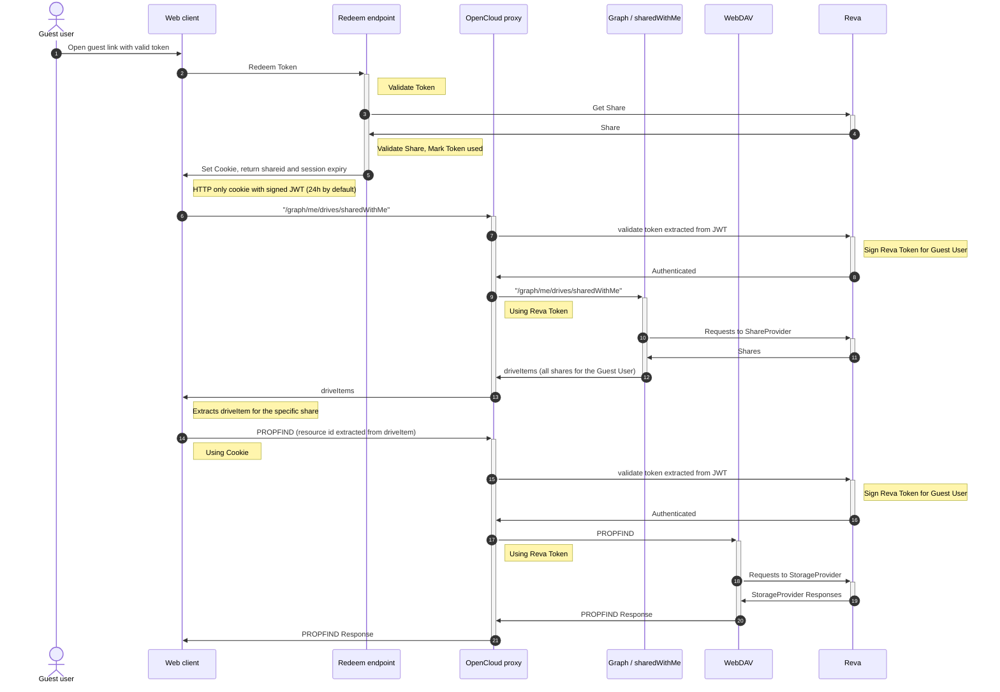
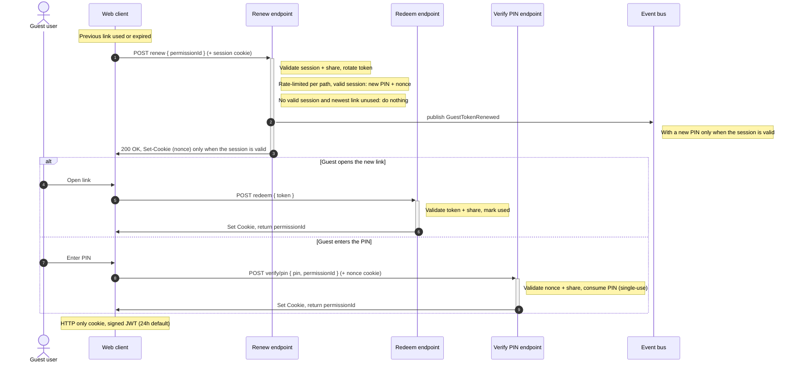

# auth-guest

The `auth-guest` service gives guest users access to a share without a full
OpenCloud account. When a share is created for a user of type
`USER_TYPE_GUEST`, the service issues a one-time guest link token; redeeming
that token exchanges it for a signed session cookie that authenticates the
guest.

When the link token is no longer valid, the guest can *renew*: the service
issues a new link token together with a one-time PIN. The guest then either
redeems the new link or exchanges the PIN for a fresh session. A new PIN (and
the nonce that binds it to the browser) is only issued when the request is
authorized by a session cookie for the share; without one the link token is
rotated silently.

The unauthenticated endpoints are protected against brute-force and abuse: the
PIN is bound to a browser-held nonce, failed PIN attempts back off exponentially
and invalidate the PIN after a maximum number of attempts, and `renew` is
limited per share (cooldown and daily cap), with separate quotas for renewals
with and without a valid session. The magic link is never affected by a PIN
lockout.

It is disabled by default. Set `OC_ENABLE_GUEST_LINKS=true` to enable the guest
links feature and start the service.

## Overview

- **Consumes** the share lifecycle events `ShareCreated`, `ShareRemoved` and
  `ShareExpired`.
- **Publishes** the `GuestTokenCreated` event (initial token) and the
  `GuestTokenRenewed` event (refresh, carrying the new token and, when
  authorized by a session, the PIN).
- Exposes unauthenticated endpoints to redeem a token, renew it and verify a
  PIN; redeeming a token or verifying a PIN sets a session cookie. `renew` and
  `verify/pin` are rate-limited.
- Stores only hashes of the token secret, of the PIN and of the nonce, and
  deletes the stored record when the share is removed or expires. 

## Guest links flow

The following sequence diagram describes the guest links flow:

## Renewal and PIN flow

A guest session (signed JWT) is valid for 24 hours by default
(`AUTH_GUEST_JWT_TTL`); a link token is single-use and valid for 30 minutes.
Verifying a token or a PIN returns the session expiry as `expirationDateTime`,
so the client can warn the guest before the session runs out, since it cannot
read the HttpOnly cookie.

Renewal starts from a *failed* attempt: `redeem` on a link that was already used
answers `409`, and on an expired link `401`; the client still holds the link
token.

`renew` requires the share id (`permissionId`). When the request carries a
session cookie with a valid, unexpired session token for that share, the service
validates the share, generates a new link token and a 6-digit PIN (30 minutes by
default), overwrites the stored token, PIN and nonce hashes (invalidating the
previous link and PIN), resets the redeemed flag, publishes `GuestTokenRenewed`
carrying the PIN, and sets the nonce cookie that binds the PIN to the requesting
browser.

Without a valid session (no cookie, an expired session token or one for
another share) the renewal is *silent*: the service validates the share,
rotates the stored token secret and expiry, resets the redeemed flag so the new
link can be redeemed, and publishes `GuestTokenRenewed` without a PIN; it
answers `200` and sets no nonce cookie. Because such a request is
unauthenticated, it is rate-limited per share.

While the newest link can still be redeemed (it is neither used nor expired), a
renewal without a valid session does nothing: it answers `200` like a real
renewal, but does not rotate the link, publish an event or count against the
quota. This path only needs the share id, so otherwise anyone who knows it
could cancel the link the guest just received. Renewals with a valid session
always issue a new link and PIN.

Both paths require an existing token record for the share; if publishing fails,
the previous record is restored.

`renew` is limited per share, with a separate quota for each path so that
neither can use up the other's:

- **Without a valid session:** a cooldown between two renewals
  (`AUTH_GUEST_QUOTA_COOLDOWN`, default 1 minute) and a daily cap
  (`AUTH_GUEST_QUOTA_DAILY_CAP`, default 50 per `AUTH_GUEST_QUOTA_WINDOW`,
  default 24 hours). A link is only replaced once it is used or expired, so
  without anyone using a link there are at most 48 renewals a day. The default
  cap stays above that, so that someone who only knows the share id can't use it
  up and lock the guest out.
- **With a valid session:** a cooldown (`AUTH_GUEST_SESSION_QUOTA_COOLDOWN`,
  default 5 minutes) and a daily cap (`AUTH_GUEST_SESSION_QUOTA_DAILY_CAP`,
  default 5 per `AUTH_GUEST_SESSION_QUOTA_WINDOW`, default 24 hours). Each of
  these renewals issues a new PIN with fresh attempts, so this quota also limits
  how many PINs someone holding a stolen session can guess. It is sized for
  refreshing a session before it expires, plus a few retries.

A request within the cooldown or over the cap is rejected with `429` and a
`Retry-After` header.

To turn the new credentials into a session the guest either redeems the link
(`verify/token`) or enters the PIN (`verify/pin`); both return a session
cookie and the `permissionId`. `verify/pin` does not consume the link token, but
it requires the nonce cookie set by `renew`, so the PIN can only be verified
from the browser that requested the renewal. Each wrong PIN increments a counter
and the wait between attempts grows exponentially; after
`AUTH_GUEST_BACKOFF_MAX_ATTEMPTS` (default 5) failures the PIN is invalidated.
While the backoff is active `verify/pin` answers `429` with a `Retry-After`
header. The magic link (`verify/token`) is not affected by any of this: it
remains usable even when the PIN is locked out.

## Token lifecycle

1. **Issue** — on the consumed `ShareCreated` event, where the grantee is a
   guest, the service generates a random secret and stores a record keyed by
   the hash of the share id. It then publishes the `GuestTokenCreated` event
   with the token.
2. **Redeem** — the guest posts the token to
   `POST /graph/v1beta1/extensions/org.libregraph/guestLinks/verify/token`.
   The service validates the token and the share, marks the token as used and
   returns a signed JWT session token in a cookie plus the share's
   `permissionId` in the response body. Tokens are single-use and valid for
   30 minutes; the session cookie lives for 24 hours by default
   (`AUTH_GUEST_JWT_TTL`).
3. **Renew** — the guest posts the `permissionId` to
   `POST /graph/v1beta1/extensions/org.libregraph/guestLinks/renew`. If the
   request carries a session cookie with a valid, unexpired session token for
   that share, the service validates the share, generates a new link token and a
   6-digit PIN (30 minutes by default), overwrites the stored token, PIN and
   nonce hashes (invalidating the previous link and PIN), resets the redeemed
   flag, publishes `GuestTokenRenewed` with the PIN and sets the nonce cookie.
   Without a session the renewal is silent: the service validates the share,
   rotates the stored token secret and expiry, resets the redeemed flag and
   publishes `GuestTokenRenewed` without a PIN; no nonce cookie is set. Each
   path is limited per share by its own quota (cooldown plus daily cap), and an
   exceeded limit fails with `429`. Without a valid session nothing happens
   while the newest link is neither used nor expired. Both paths require an
   existing record; otherwise the request fails with `tokenNotFound`. If
   publishing fails, the previous record is restored.
4. **Verify PIN** — the guest posts the PIN, the `permissionId` and the nonce
   cookie to
   `POST /graph/v1beta1/extensions/org.libregraph/guestLinks/verify/pin`.
   The service validates the nonce, the record and the share, compares the PIN
   against the stored argon2id hash and, on success, clears the PIN (single-use)
   and returns a signed JWT session token in a cookie plus the share's
   `permissionId`. Each wrong PIN increments a counter and increases the wait
   before the next attempt; after the maximum number of failed attempts the PIN
   is invalidated and while the backoff is active the endpoint answers `429`.
   Verifying the PIN does not consume the magic link.

### Endpoints

All error responses have the body
`{ "errorType": "<type>", "message": "<msg>", "permissionId": "<share-id>" }`.
Rate-limited responses (`429`) also carry a `retryAfter` field (seconds) and a
`Retry-After` header.

#### `POST .../guestLinks/verify/token`

- **Request body:** `{ "token": "<token>" }`
- **Success:** `200`, session cookie,
  `{ "permissionId": "<share-id>" }`
- **Errors:** `400 invalidRequest`, `401 tokenInvalid`,
  `401 tokenExpired`, `404 tokenNotFound`, `409 tokenAlreadyRedeemed`,
  `404 shareNotFound`, `410 shareExpired`, `500 internalError`

#### `POST .../guestLinks/renew`

- **Request body:** `{ "permissionId": "<share-id>" }`
- **Authorization:** the session cookie, when it carries a valid, unexpired
  session token for the given share; without it the renewal is silent (no PIN,
  no nonce cookie)
- **Success:** `200`, no session cookie. With a valid session a new link and
  PIN are sent by mail and the nonce cookie is set. Without one a new link is
  sent by mail, unless the newest link can still be redeemed, in which case
  nothing happens; the response is the same either way.
- **Errors:** `400 invalidRequest`, `404 tokenNotFound`, `404 shareNotFound`,
  `409 conflict`, `410 shareExpired`, `429 tooManyRequests` (with
  `Retry-After`), `503 serviceUnavailable`, `500 internalError`

#### `POST .../guestLinks/verify/pin`

- **Request body:** `{ "pin": "<pin>", "permissionId": "<share-id>" }`
- **Required cookie:** the nonce cookie set by `renew`
- **Success:** `200`, session cookie, clears the nonce cookie,
  `{ "permissionId": "<share-id>" }`
- **Errors:** `400 invalidRequest` (missing nonce cookie), `401 nonceInvalid`,
  `401 nonceExpired`, `401 pinInvalid`, `401 pinExpired`, `404 tokenNotFound`,
  `404 shareNotFound`, `410 shareExpired`, `429 tooManyRequests` (with
  `Retry-After`), `500 internalError`

## Frontend integration

The three endpoints are unauthenticated and rely on cookies, so the client must
send credentials with every request (for example `credentials: 'include'` in
`fetch`). Cross-origin deployments also need the service CORS to allow the
origin and credentials; the default `AUTH_GUEST_CORS_ALLOW_ORIGINS` of `*` is
not sufficient together with credentials, so set a concrete origin.

The PIN is bound to the browser that renewed, so the order matters:

1. `renew` — sets the nonce cookie on the response when a session authorized the
   renewal (which issues the PIN); a silent renewal sets no nonce cookie.
2. `verify/pin` — the browser sends the nonce cookie back automatically; a
   successful response clears it and sets the session cookie.

The nonce cookie is `HttpOnly`, `Secure`, `Path=/`, `SameSite=Lax` and uses the
`__Host-` prefix, so it is only sent over HTTPS (browsers treat `localhost` as
secure) and cannot be read from JavaScript. It is scoped per share (a short
share-id hash is appended to the name), so multiple guest shares can be renewed
in one browser without overwriting each other's nonce cookie.

Client-side handling of the relevant responses:

- `200` from `renew` without a session — a new link may or may not have been
  sent; tell the guest to use the link from their newest mail.
- `400 invalidRequest` "The nonce cookie is missing from the request." — the
  browser has no nonce (it never renewed, or the cookie expired): call `renew`
  again before `verify/pin`.
- `401 nonceInvalid` / `401 nonceExpired` — the nonce does not match or has
  expired: call `renew` again to get a fresh PIN and nonce.
- `401 pinInvalid` — wrong PIN; the wait between attempts grows, so retry with a
  delay.
- `401 pinExpired` — the PIN expired; call `renew` again.
- `404 tokenNotFound` — no guest link exists for this share; it has to be
  invited again.
- `409 conflict` — the share's record was updated concurrently; retry `renew`.
- `429 tooManyRequests` — too many failed attempts, or the renewal cooldown or
  cap is active; wait for the `Retry-After` header (or the `retryAfter` field)
  in seconds, then retry.

## Configuration

The service is configured via `AUTH_GUEST_*` environment variables or a
`auth-guest.yaml` file.

Both transports are enabled by default: the service consumes and publishes
events and serves the HTTP endpoints. Either transport can be disabled:

- `AUTH_GUEST_EVENTS_DISABLED=true` — the service does not consume events
  (no tokens are created or cleaned up) and `renew` cannot publish its event,
  so it responds with `503 serviceUnavailable`.
- `AUTH_GUEST_HTTP_DISABLED=true` — the service does not serve the HTTP
  endpoints (`verify/token`, `renew`, `verify/pin`).

The link token lifetime is fixed (30 minutes). The lifetime of the one-time PIN
and of the nonce that protects it is shared and configurable. The rate-limiting
and nonce options are:

- `AUTH_GUEST_NONCE_COOKIE_BASE_NAME` (default `__Host-oc_guest_nonce`; a short
  share-id hash is appended per share, e.g. `__Host-oc_guest_nonce_<hash>`) —
  base name of the nonce cookie set by `renew` and required by `verify/pin`.
- `AUTH_GUEST_PIN_AND_NONCE_TTL` (default `30m`) — lifetime of the one-time PIN
  and of the nonce that binds it to the browser.
- `AUTH_GUEST_BACKOFF_MAX_ATTEMPTS` (default `5`),
  `AUTH_GUEST_BACKOFF_BASE` (default `1s`),
  `AUTH_GUEST_BACKOFF_CAP` (default `30s`) — failed PIN attempts before the PIN
  is invalidated, and the exponential backoff between attempts.
- `AUTH_GUEST_QUOTA_DAILY_CAP` (default `50`),
  `AUTH_GUEST_QUOTA_COOLDOWN` (default `1m`),
  `AUTH_GUEST_QUOTA_WINDOW` (default `24h`) — maximum renewals per share per
  window and the minimum time between two renewals (applies to `renew` without a
  valid session).
- `AUTH_GUEST_SESSION_QUOTA_DAILY_CAP` (default `5`),
  `AUTH_GUEST_SESSION_QUOTA_COOLDOWN` (default `5m`),
  `AUTH_GUEST_SESSION_QUOTA_WINDOW` (default `24h`) — the same for `renew` with a
  valid session, which issues a new PIN; counted separately.

Relevant options:

- `AUTH_GUEST_JWT_COOKIE_NAME`, `AUTH_GUEST_JWT_TTL` — session cookie name and
  lifetime.
- Guest session tokens are signed with a key derived from `OC_JWT_SECRET`. There
  is no separate secret to configure; rotating `OC_JWT_SECRET` invalidates all
  guest sessions.
- `AUTH_GUEST_TOKENS_STORAGE_ROOT` — where guest link token records are stored.
- `AUTH_GUEST_SERVICE_ACCOUNT_ID`, `AUTH_GUEST_SERVICE_ACCOUNT_SECRET` — service
  account used to query the gateway for share metadata.
- `AUTH_GUEST_NUM_CONSUMERS` — number of concurrent event consumers.
- `OC_REVA_GATEWAY` — CS3 gateway used to look up shares.
