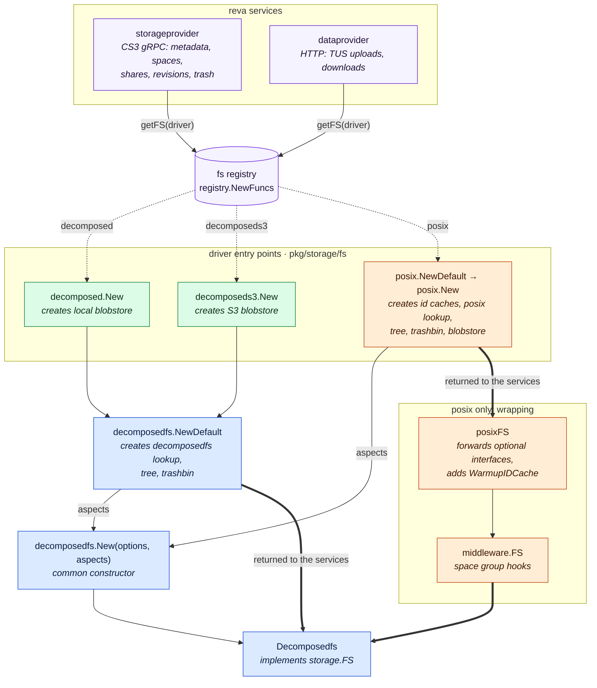
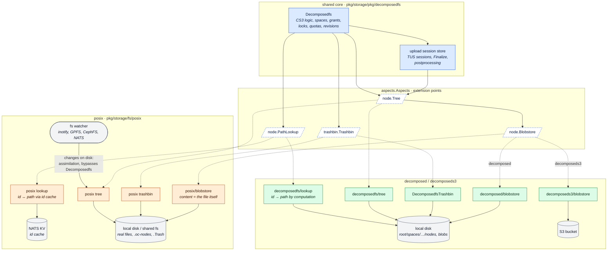
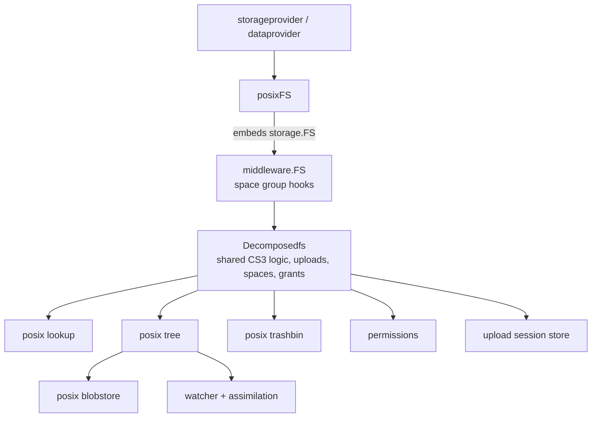

# decomposedfs and the drivers built on it

This package is the shared core of three storage drivers:

| driver         | package                         | where file content lives                      | where metadata lives                         |
|----------------|---------------------------------|-----------------------------------------------|----------------------------------------------|
| `decomposed`   | `pkg/storage/fs/decomposed`     | blobs on local disk                           | node files in a private directory tree        |
| `decomposeds3` | `pkg/storage/fs/decomposeds3`   | blobs in an S3 bucket                         | node files in a private directory tree       |
| `posix`        | `pkg/storage/fs/posix`          | the user's files themselves, as they appear on disk | extended attributes on those files     |

`decomposed` and `decomposeds3` "decompose" a file tree into nodes, metadata and blobs, so the files are not recognizable on disk.
`posix` keeps a normal, browsable directory tree, which may also be changed directly on disk, and keeps its own data in extended attributes and hidden directories.
Despite these differences, all three share most of their logic (the CS3 API, uploads, spaces, shares/grants, locks, revisions, quotas) through this package.

> **Note:** `pkg/storage/utils/decomposedfs` is an older copy of this package. It is still used by the legacy `ocis` and `s3ng` drivers.
> New work goes into `pkg/storage/pkg/decomposedfs` (this package); see commit 6d021d812, "Add a new version of the decomposedfs lib which we'll use moving forward".

## Architecture overview

### How requests reach the storage



### Components and extension points



How to read them:

- **Colours:** blue is the shared core in this package, green the code used only by `decomposed`/`decomposeds3`, orange the code used only by `posix`, grey the external systems, and purple the callers.
- **First diagram:**
  - dotted arrows are lookups by driver name in the registry;
  - thin arrows show what a constructor calls or builds;
  - thick arrows show the object that is handed back to the services and the chain a request then travels through.
- **Second diagram:**
  - solid arrows are calls at runtime;
  - dotted arrows lead from an interface to the implementation each driver plugs in through `aspects.Aspects`.
- **Two paths into the storage:** requests from the services enter through `Decomposedfs` for all drivers (posix wraps it in `posixFS` and `middleware.FS` first). Changes made directly on disk enter only through the posix watcher and the tree's assimilation, which bypasses `Decomposedfs` and the upload code entirely.
- **Not shown:** the shared helpers `permissions`, `spaceidindex`, `node`, `metadata`, `tree/propagator` and `revisioncleanup`, and the NATS event stream used for async postprocessing. They are described in the sections below.

## From configuration to a running driver

### Registration

Every driver registers a constructor in the storage driver registry (`pkg/storage/fs/registry`) from an `init()` function:

```go
// pkg/storage/fs/decomposed/decomposed.go
func init() { registry.Register("decomposed", New) }

// pkg/storage/fs/decomposeds3/decomposeds3.go
func init() { registry.Register("decomposeds3", New) }

// pkg/storage/fs/posix/posix.go
func init() { registry.Register("posix", NewDefault) }
```

`pkg/storage/fs/loader` imports all driver packages for their side effect, so importing the loader makes every driver available.

### Who creates the driver

Two services look up the configured driver by name in `registry.NewFuncs` and call its constructor with the driver's config map and the event stream:

- the CS3 **storage provider** gRPC service (`internal/grpc/services/storageprovider`, `getFS`): metadata operations, listing, spaces, shares, locks, revisions, trash
- the **data provider** HTTP service (`internal/http/services/dataprovider`, `getFS`): up- and downloads, e.g. TUS uploads via the data transfer handlers in `pkg/rhttp/datatx`

Each service creates its own instance of the driver from the same configuration, even when both run in the same process.
So anything a driver keeps in memory is not shared between the two, and shared state has to live on disk, in the metadata cache or in NATS.

## How a driver builds itself

The central type is `Decomposedfs` (`decomposedfs.go`). It implements `storage.FS` and the optional interfaces (TUS uploads, upload session listing, ...).
It does not touch the storage layout itself, though. Everything layout specific is delegated to a set of components that each driver supplies in an `aspects.Aspects` struct:

```go
// aspects/aspects.go
type Aspects struct {
	Lookup            node.PathLookup           // resolves ids and references to nodes and paths
	Tree              node.Tree                 // creates, moves, deletes nodes; blobs; revisions; propagation
	Trashbin          trashbin.Trashbin         // lists, restores and purges trashed items
	Permissions       permissions.Permissions   // assembles CS3 permissions from grants
	EventStream       events.Stream             // NATS events, e.g. for async postprocessing
	DisableVersioning bool
	UserMapper        usermapper.Mapper         // maps users to unix ids (posix with space groups)
	RevisionsCleanup  *revisioncleanup.Service // deletes old revisions (in background workers by default), disabled without a strategy
}
```

`decomposedfs.New(options, aspects, log)` is the common constructor all drivers end up calling. It:

1. calls `aspects.Tree.Setup()` to create the storage layout,
2. sets up the space indexes (`spaceidindex`: by user, group, mail, type) under `<root>/indexes`,
3. creates the `Decomposedfs` from the aspects,
4. creates the upload session store (`upload.NewSessionStore`), which gets the same aspects,
5. calls `Trashbin.Setup(fs)` so the trashbin can call back into the storage,
6. with async uploads enabled, subscribes to the postprocessing events and starts `Decomposedfs.Postprocessing` consumers.

### decomposed and decomposeds3: `NewDefault`

Both drivers only create their blobstore and then hand over to `decomposedfs.NewDefault`:

```
decomposed.New(config)                      decomposeds3.New(config)
  options.New(config)                         parseConfig(config), check S3 settings
  blobstore.New(root)  (local disk)           blobstore.New(endpoint, bucket, ...)  (S3)
        \                                       /
         `---> decomposedfs.NewDefault(config, blobstore, stream, log)
                 options.New(config)
                 lookup.New(metadata backend: messagepack (default) or xattrs)
                 permissions.NewPermissions(...)
                 tree.New(lookup, blobstore, options, permissions, id cache)
                 revisioncleanup.NewServiceFromOptions(options, lookup, tree)  (starts the cleanup workers)
                 Aspects{Lookup, Tree, Permissions, Trashbin: &DecomposedfsTrashbin{}, ...}
                 decomposedfs.New(options, aspects)
```

The blobstore is the only thing that differs between the two, everything else comes from this package:
`lookup` (`decomposedfs/lookup`), `tree` (`decomposedfs/tree`) and the trashbin `DecomposedfsTrashbin` (`recycle.go`).

### posix: its own components around the same core

`posix.NewDefault` sets up the NATS key-value id caches posix depends on, then calls `posix.New`. That function replaces almost every aspect with a posix specific implementation:

```
posix.NewDefault(config)
  options.New(config)            posix options embed the decomposedfs options;
                                 defaults: metadata backend "hybrid", scan debounce, inotify stats
  idcache (NATS KV)              id -> path cache, plus a history cache for moved/deleted ids
  posix.New(options, stream, idcache, historyCache)
    usermapper                   unix mapper with use_space_groups, null mapper otherwise
    posix lookup.New(...)        metadata backend "hybrid" (default) or "xattrs"
    permissions.NewPermissions   (shared with decomposedfs)
    posix trashbin.New + Setup   freedesktop.org style '.Trash' per space
    posix blobstore.New(root)    writes the content into the actual file
    posix tree.New(...)          creates the revision cleanup (and its workers), starts the fs
                                 watcher and the initial scan, if configured
    Aspects{...posix components...}
    decomposedfs.New(options, aspects)       the shared core, as above
    middleware.NewFS(dfs, hooks...)          optional space group scoping hooks
    posixFS{FS: middleware, tree, um}        the storage.FS that is returned
```

The result is layered like this:



For `decomposed` and `decomposeds3`, `NewDefault` returns the `Decomposedfs` directly, with no wrapper or middleware.

## Delegation and overriding

### Decomposedfs delegates layout specifics to the aspects

Most `Decomposedfs` methods follow the same pattern: resolve a reference with the lookup, check permissions, then ask the tree to do the work. For example:

- `CreateDir`, `Move`, `Delete`, `ListFolder` → `fs.lu.NodeFromResource` → `fs.p.AssemblePermissions` → `fs.tp.CreateDir/Move/Delete/ListFolder`
- `ListRevisions`, `DownloadRevision` → `fs.tp.ListRevisions/DownloadRevision`
- `ListRecycle`, `RestoreRecycleItem`, `PurgeRecycleItem`, `EmptyRecycle` → `fs.trashbin`
- size and etag propagation after changes → `fs.tp.Propagate`
- uploads → `fs.sessionStore` → `tp.InitNewNode`, `tp.CreateRevision`, `tp.WriteBlob`

The interfaces that define those contracts live in `node/node.go` (`Tree`, `PathLookup`, `Blobstore`), `trashbin/trashbin.go` and `permissions/`.
They are the place to look when a feature needs driver specific behaviour.
Typically a method is added to the interface and implemented in both `decomposedfs/tree` and `fs/posix/tree`.
`Tree.ListRevisionsUnchecked` is a recent example, used by the revision cleanup (see `revisioncleanup`).

Before adding such a method, check whether the shared code already handles both layouts.
`Node` methods work through the lookup, so they resolve paths correctly for every driver.
For example, deleting a single revision needs no driver-specific code: `Node.DeleteRevisionUnchecked` removes the revision and returns its blob id, and `Tree.DeleteBlob` deletes the blob in whichever blobstore the driver uses.
`revisioncleanup.PurgeRevisionUnchecked` combines the two for all drivers.

Shared building blocks that both trees use instead of re-implementing them:

- `node` – the `Node` type, its attributes, locks, grants and processing status
- `metadata` – the metadata backends (`messagepack`, `xattrs`, `hybrid`) and the file metadata cache
- `tree/propagator` – tree size and mtime propagation (used by both trees)
- `upload` – TUS upload sessions, `Finalize`, postprocessing integration
- `permissions` – CS3 permission assembly from grants and the permissions service
- `revisioncleanup` – applying the revision cleanup strategy, right away or in background workers; documented in [`revisioncleanup/README.md`](revisioncleanup/README.md)

### What differs per component

| aspect     | decomposed / decomposeds3 | posix |
|------------|---------------------------|-------|
| **lookup** (`InternalPath`) | computed from the ids: `<root>/spaces/<spaceid>/nodes/<pathified nodeid>`; children are found through symlinks named after the child in the parent's node directory | the real path of the file, looked up in the NATS KV id cache (id → path); `IDsForPath` goes the other way |
| **metadata** | `messagepack` (`.mpk` file next to the node, default) or `xattrs` | `hybrid` (xattrs, large values spill over into `.mpk` files in `.oc-nodes`, default) or `xattrs`; the node id is stored in an xattr on the file |
| **blobstore** | local blob directory or S3 bucket, addressed by blob id | no separate blobs: `Upload` moves or copies the uploaded file into the real file path; `Delete` is a no-op |
| **tree** | creates/moves nodes by manipulating node files and symlinks | creates/moves real files and directories; additionally watches the file system and *assimilates* external changes (new ids, metadata, revisions with `enable_fs_revisions`) |
| **revisions** | `<node>.REV.<mtime>` node file next to the node, content in a blob | full copy in `<space>/.oc-nodes/<pathified id>.REV.<mtime>`; with `enable_fs_revisions` a `.CURRENT` copy is kept to create revisions from changes on disk |
| **trash** | deleted nodes are renamed in place to `<node>.T.<deletion time>`, and a symlink in `<root>/spaces/<spaceid>/trash` points to them | freedesktop.org style `<space>/.Trash/{files,info}` with `.trashinfo` files |
| **spaces** | space roots at `<root>/spaces/<pathified spaceid>`, derived from the id | space roots are directories at the paths given by `personalspacepath_template` and `generalspacepath_template` (evaluated by the shared `CreateStorageSpace`, but only the posix lookup places space roots there) |
| **wrapping** | `Decomposedfs` returned as is | `posixFS` → `middleware.FS` → `Decomposedfs` |

### How posix overrides and extends `Decomposedfs`

`posixFS` embeds a `storage.FS` (the middleware wrapping `Decomposedfs`), so every `storage.FS` method is forwarded automatically.
Go only promotes the methods of the embedded *interface type*, though, not those of the concrete type behind it.
That means optional interfaces that `Decomposedfs` implements in addition to `storage.FS` would be invisible on `posixFS`.
`posixFS` therefore forwards them explicitly with type assertions, e.g. `UseIn` (`storage.ComposableFS`), `NewUpload`/`GetUpload` (`tusd.DataStore`), `ListUploadSessions` and `WithDisabledSpaces`.
It also adds posix-only methods such as `WarmupIDCache`.
When `Decomposedfs` gains a new optional interface, posix only supports it once a forwarding method is added to `posixFS`.

Other places where posix hooks into the shared code:

- **Middleware hooks** (`pkg/storage/utils/middleware`): with `use_space_groups`, every call first resolves the space's unix group and scopes the process to it, so files are created with the right group ownership.
- **Trashbin setup:** `Trashbin.Setup(fs)` is called twice for posix: in `posix.New` with the `posixFS` wrapper (not filled in yet at that point), and in `decomposedfs.New` with the inner `Decomposedfs`. The posix trashbin keeps the first reference and ignores the second, but currently does not use it otherwise. `DecomposedfsTrashbin` on the other hand requires a `*Decomposedfs` and uses it to implement trash operations.
- **Driver specific behaviour inside the shared code** is selected through the aspects, not through type switches. For example, the upload store calls `tp.WriteBlob`, which in posix moves the upload into the real file and updates `.CURRENT`, while in decomposedfs it uploads a blob.

### Changes on disk (posix only)

`decomposed` and `decomposeds3` assume they are the only writers.
posix allows changes to the files on disk, and picks them up through the watcher configured with `watch_fs`/`watch_type`: inotify, GPFS, CephFS or NATS.
It can also scan the whole tree at startup (`scan_fs`).
Detected changes are queued (`ScanDebouncer`) and *assimilated* (`tree/assimilation.go`): new files get an id and metadata, moved files keep their id via the id cache, and sizes are propagated.
With `enable_fs_revisions` a revision is created from the previous `.CURRENT` copy.
This path bypasses `Decomposedfs` and the upload code completely, so any feature that hooks into uploads (e.g. revision cleanup, postprocessing) needs a separate trigger in assimilation if it should also apply to changes on disk.

The inotify watcher starts `inotifywait` with `KillOthers`, which runs `pkill inotifywait`.
Only one watching posix instance per host is therefore possible, which matters for tests (see `fs/posix/tree/export_test.go`).

## Where to start reading

- `decomposedfs.go` – `NewDefault`, `New`, the `Decomposedfs` struct, `Postprocessing`
- `aspects/aspects.go` – the extension points
- `node/node.go` – `Node`, and the `Tree`, `PathLookup` and `Blobstore` interfaces
- `upload/` – `store.go` (`CreateNodeForUpload`, `updateExistingNode`), `upload.go` (`FinishUpload*`, `Finalize`, `Cleanup`)
- `pkg/storage/fs/posix/posix.go` – how posix assembles its aspects and wraps the result
- `pkg/storage/fs/posix/tree/assimilation.go` – how changes on disk are picked up
